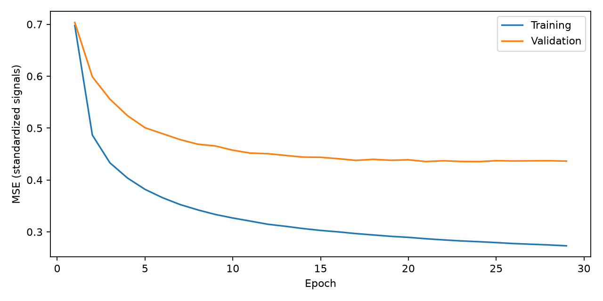
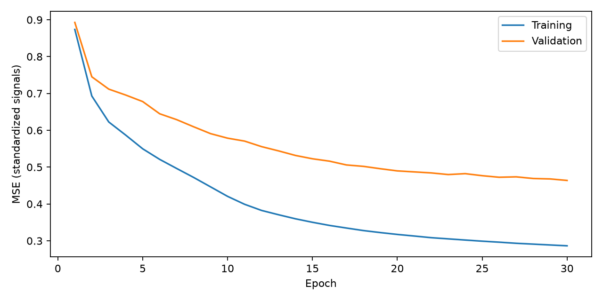
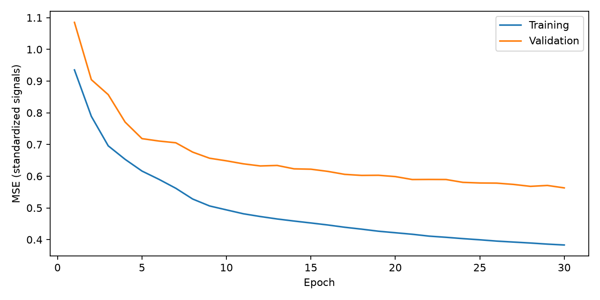
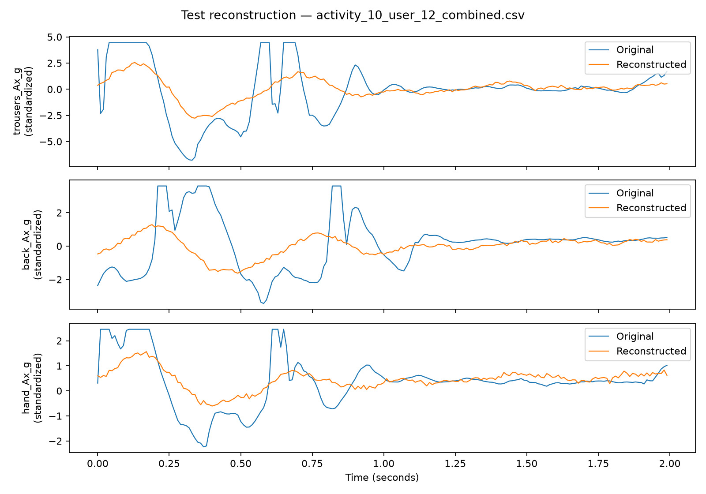
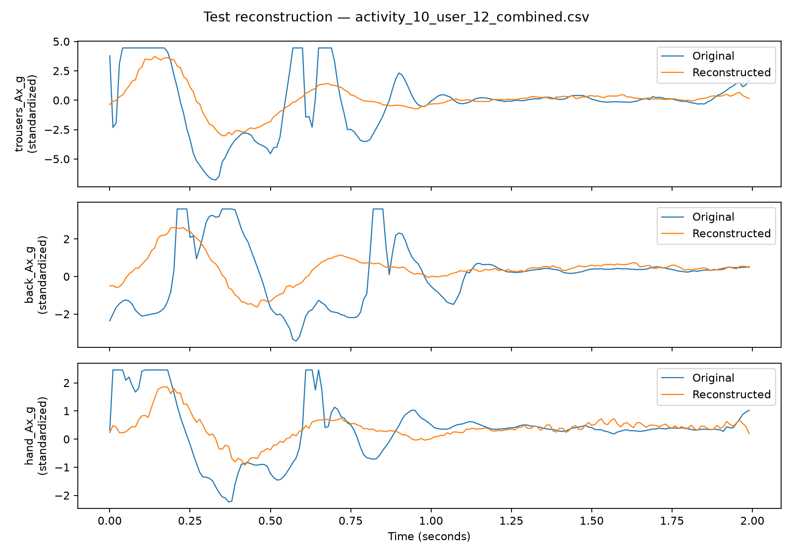
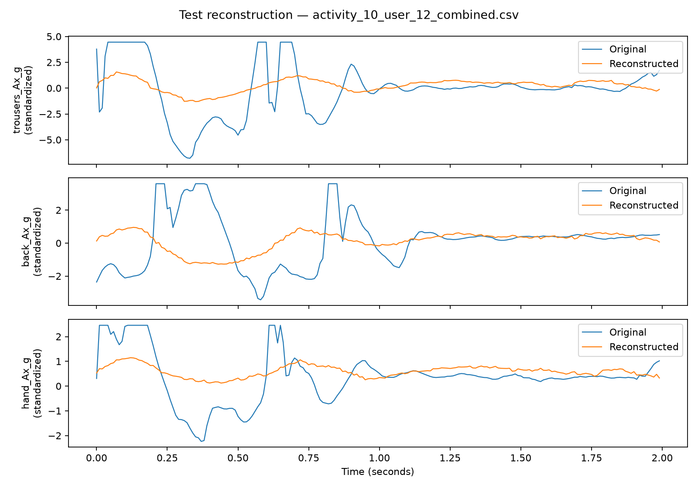

# Motion Atlas — Hackathon Day 1

**Project:** AI Methods I hackathon, Group 3  
**Date:** Monday, 16 November 2026  
**Working idea:** an interactive way to explore and compare construction-worker movements from wearable sensors.

## What we did today

- Chose the **VTT-ConIoT** construction-worker motion dataset.
- Loaded and audited **207 IMU recordings** from 13 participants performing up to 16 activities.
- Prepared fixed-length sensor windows and split participants—not individual windows—between training, validation, and test sets.
- Trained and compared a dense autoencoder and two 1D convolutional autoencoders.
- Saved model weights, input-scaling values, configuration files, metrics, loss curves, and test reconstruction plots.
- Selected **Motion Atlas** as the direction for the app: explore movement examples and find recordings with similar patterns. Similarity search is a next step; today’s models are evaluated on reconstruction error.

## Dataset

VTT-ConIoT contains wearable inertial-sensor measurements from **13 people** performing **16 activities** relevant to construction work. Sensors are worn at the **trousers, back, and hand**. The archive also contains video-derived body-pose keypoint CSVs.

The activities are roll painting, spraying paint, levelling paint, vacuum cleaning, picking objects, climbing stairs, jumping down, laying back, hands-up work at high and low levels, crouching on the floor, kneeling on the floor, walking straight, walking winding, pushing a cart, and stairs up-down.

The models use **18 channels**: acceleration (`Ax`, `Ay`, `Az`) and gyroscope (`Gx`, `Gy`, `Gz`) at each of the three sensor locations. Timestamps, magnetometer, barometer, and precomputed total-magnitude fields are not model inputs in these runs.

### Preprocessing and splits

- Sampling rate: **100 Hz**.
- Window length: **200 samples (2 seconds)**.
- Training stride: **100 samples (1 second)**; evaluation stride: **200 samples (2 seconds)**.
- Each channel is standardized using the mean and standard deviation from training participants only.
- Participant split: users **1–9** for training, **10–11** for validation, and **12–13** for testing. Participants do not overlap between splits.
- Random seed: **42**; batch size: **128**; maximum: **30 epochs**; early-stopping patience: **5**.
- Resulting windows: **8,295 train / 929 validation / 928 test**.

Activity labels are retained as metadata for analysis; the autoencoders learn by reconstructing their input windows.

## Model comparison

All three models used the same sensor channels, participant split, windowing, and standardization. MSE is calculated on standardized sensor signals; lower values mean more accurate reconstruction. The baseline reconstructs each channel as zero after standardization (the training-set mean).

| Setup | Architecture | Latent size | Parameters | Best validation MSE | Test MSE |
|---|---|---:|---:|---:|---:|
| 1 | Dense autoencoder | 32 | 1,884,336 | **0.43460** | **0.34056** |
| 2 | 1D convolutional autoencoder | 32 | 164,786 | 0.46382 | 0.36872 |
| 3 | 1D convolutional autoencoder | 16 | 113,570 | 0.56310 | 0.45708 |
| Baseline | Training-channel mean | — | — | — | 1.01121 |

Parameter counts are derived from each model’s layer dimensions. The dense AE has the lowest test MSE in these runs, about **66% below the baseline**. The 32-value convolutional AE is close, with about **64% lower** test MSE, while using substantially fewer parameters. Reducing the convolutional latent size to 16 increases test error to 0.45708, showing a reconstruction trade-off from stronger compression.

**Current best by reconstruction error: the dense AE.** This does not yet prove it is best for Motion Atlas’s future similarity search; we still need to check whether nearest neighbors in each model’s latent space share the expected activity labels.

Training time was not recorded in the metrics files, so it is not included here. Record elapsed time in the next comparison if required for the course table.

## Training curves

Training and validation loss both fall across the runs. Validation loss stays above training loss, but does not turn upward late in training. This shows a generalization gap without a clear late-epoch validation collapse.

### Dense AE



### Convolutional AE — latent size 32



### Convolutional AE — latent size 16



## Test reconstructions

These plots compare original and reconstructed signals for one fixed test window from `activity_10_user_12_combined.csv`. The models generally follow broad trends, but smooth or miss some abrupt peaks and dips. This is visible in all three plots and is an important limitation for short, sharp movements.

### Dense AE



### Convolutional AE — latent size 32



### Convolutional AE — latent size 16



## What the results show—and do not show

**Demonstrated today:** the models reconstruct two-second IMU windows from held-out participants more accurately than the training-mean baseline. The project includes test reconstruction plots and per-window reconstruction-error reports.

**Still to build:** Motion Atlas’s central interaction—encode a new window, find nearest examples in latent space, and show their activity labels. Reconstruction MSE alone does not measure the quality of those matches. We should evaluate nearest-neighbor activity agreement before describing the app as an activity matcher.

These outputs are an exploratory prototype, not a safety, ergonomic, or work-quality assessment. The dataset has 13 participants and its held-out test group contains two participants; conclusions about new people should be cautious.

## Project outputs

- `src/train_autoencoder.py` — dense AE training script.
- `src/train_autoencoder v2.py` — convolutional AE, latent size 32.
- `src/train_autoencoder_conv16.py` — convolutional AE, latent size 16.
- `models/` — model weights, scaler values, and configuration JSON files.
- `reports/` — metrics, training histories, data audit, per-window/per-activity errors, loss curves, and reconstruction figures.
- `data/` — local dataset files; excluded from Git by `.gitignore`.

## Re-running the models

Run from the repository root in a Python environment with PyTorch, NumPy, pandas, and Matplotlib installed. The dataset must be extracted under `data/VTT_ConIot_Dataset/`.

```powershell
python .\src\train_autoencoder.py
python ".\src\train_autoencoder v2.py"
python .\src\train_autoencoder_conv16.py
```

Each script writes its model artifacts and reports to the corresponding folders under `models/` and `reports/`.

## Dataset images and visual direction

The local VTT-ConIoT archive contains CSV and text files, not ready-to-embed photographs or video frames. It does include pose-keypoint CSVs. A useful later addition would be a **stick-figure pose visualization generated from those keypoints** for one sample activity, ideally beside its sensor traces. That would be more relevant to Motion Atlas than stock imagery and would avoid embedding identifiable participant photographs.

## Source and attribution

Dataset: [VTT-ConIoT on Zenodo](https://doi.org/10.5281/zenodo.4683703). The course `DATASETS.md` lists the dataset as CC BY 4.0; cite the dataset and paper when using it, and check the source record before redistributing raw files.

Mäkelä, S.-M., Lämsä, A., Keränen, J. S., Liikka, J., Ronkainen, J., Peltola, J., Häikiö, J., Järvinen, S., & López, M. B. (2022). “Introducing VTT-ConIoT: A Realistic Dataset for Activity Recognition of Construction Workers Using IMU Devices.” *Sustainability, 14*(1), 220. [https://doi.org/10.3390/su14010220](https://doi.org/10.3390/su14010220).
